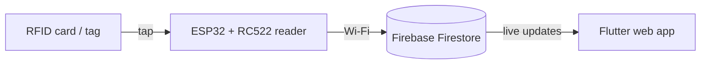
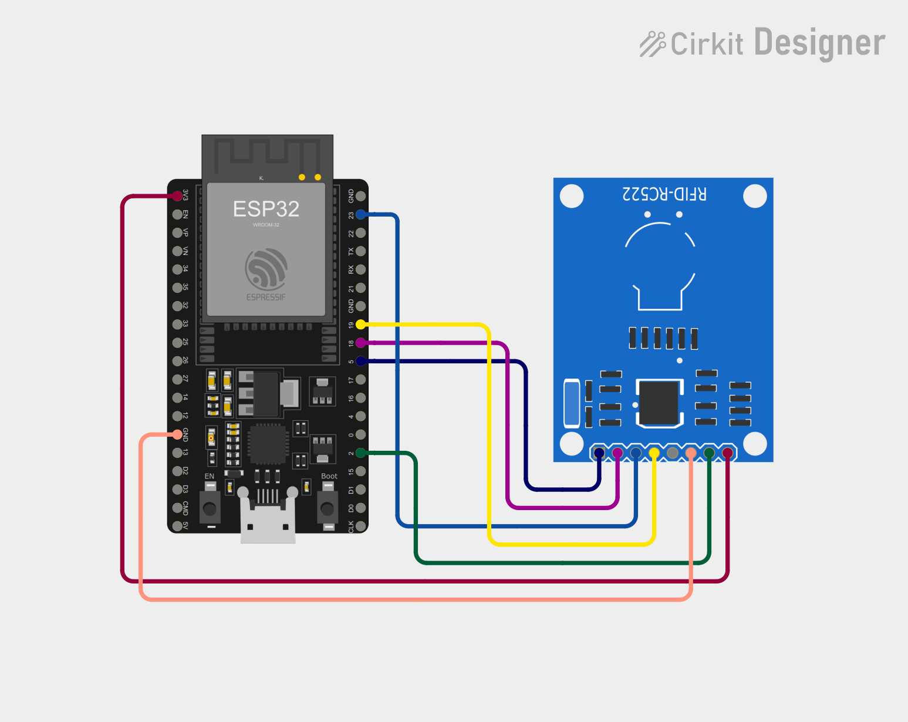

# Kayak RFID Asset Manager

An RFID-based asset management system for kayaks and paddling gear. Tap a tag on the reader to check a kayak, paddle or life jacket **out** to a paddler, or back **in** to the boathouse. Everything updates live in a web app.

Built with an **ESP32 + RC522 RFID reader**, **Firebase Firestore** and a **Flutter web app**, as part of assisting and developing web apps and hardware for UNITEN students.

## Features

- **Dashboard:** live counts (total gear, out on the water, overdue returns, in the boathouse) and the latest movements.
- **Asset Out:** scan a tag, then record the paddler, activity, expected return date, condition and notes. Each movement gets a reference number.
- **Asset In:** scan a tag to see who has the item and whether it is overdue, then record who returned it, who received it, the rack and the gear check.
- **All assets:** every kayak and piece of gear, with its status and location.
- **Register:** link a new RFID tag to a kayak or piece of gear.
- **Works anywhere:** the app is hosted online; the reader only needs power and Wi-Fi.

## How it works



The ESP32 and the web app never talk to each other directly. The ESP32 writes each tag it reads to Firestore (`readers/counter-1`), and the open Asset Out / Asset In / Register page reacts to it within about a second.

## Hardware



| RC522 | SDA | SCK | MOSI | MISO | RST | 3.3V | GND |
| --- | --- | --- | --- | --- | --- | --- | --- |
| **ESP32** | GPIO 5 | GPIO 18 | GPIO 23 | GPIO 19 | GPIO 2 | 3V3 | GND |

Parts list and notes: [`hardware/README.md`](hardware/README.md)

## Repository structure

```
├── app/                    Flutter web app (all app code in app/lib/main.dart)
├── firmware/
│   ├── rfid_tester/        ESP32: print tag UIDs to the Serial Monitor (wiring test)
│   └── rfid_reader/        ESP32: send tags to Firebase over Wi-Fi
├── hardware/               Parts list and wiring
└── docs/
    ├── TUTORIAL.md         Full beginner step-by-step tutorial
    └── images/             Wiring diagram
```

## Getting started

Follow the full guide in **[docs/TUTORIAL.md](docs/TUTORIAL.md)**. In short:

1. Wire the RC522 to the ESP32 and upload `firmware/rfid_tester` to check that tags are read.
2. Create a Firebase project with a Firestore database.
3. Copy `firmware/rfid_reader/src/secrets.example.h` to `secrets.h`, fill in your Wi-Fi and Firebase details, and upload `firmware/rfid_reader`.
4. In `app/`, run `flutterfire configure`, then `flutter run -d chrome`.
5. Put the app online with `flutter build web` and `firebase deploy --only hosting`.

## Data (Firestore)

| Collection | What it stores |
| --- | --- |
| `readers/{readerId}` | The last tag read by each ESP32 reader |
| `assets/{tagId}` | Each kayak or piece of gear: name, type, location, status (in/out), who has it, due date |
| `movements/{autoId}` | History of every Asset Out and Asset In, with a reference number |

## Tech stack

ESP32 (C++, PlatformIO, MFRC522 library) · Flutter & Dart · Firebase Firestore · Firebase Hosting

## Security note

This version is set up for learning: Firestore runs in **test mode**, and the ESP32 writes without a login. Before real use, add Firebase Authentication to the app, give the reader its own credentials, and lock the Firestore security rules. Secrets (`secrets.h`, `firebase_options.dart`) are excluded from this repository by `.gitignore`.

## Author

T. Aiman Harith
