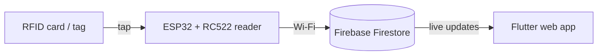
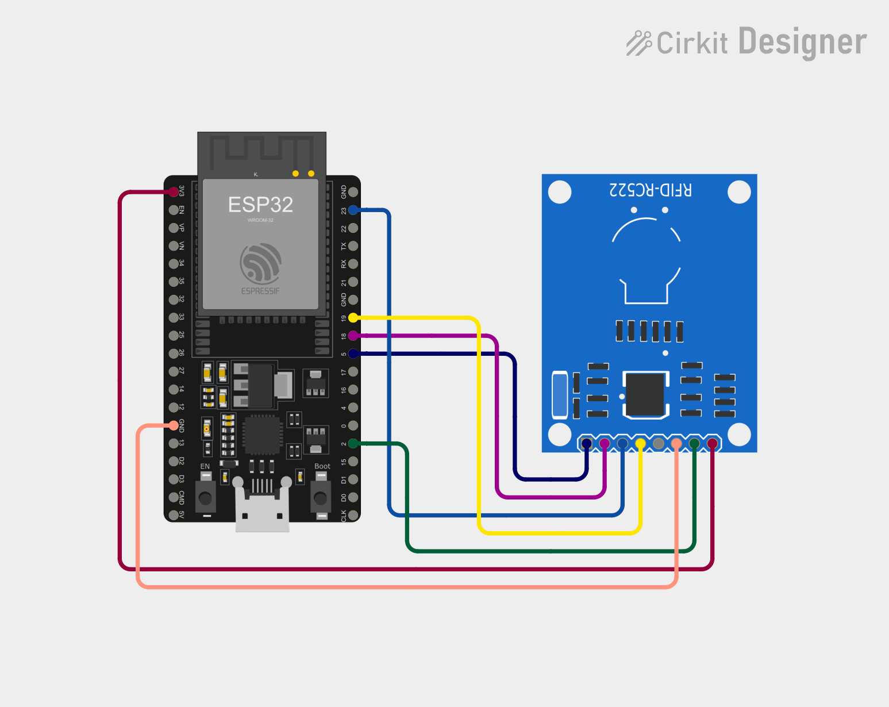

# RFID Asset Manager: Simple Step-by-Step Tutorial

_Last updated: 21 October 2026_

## How it works

The ESP32 reads the tag, sends it to Firebase, and the web app shows it. The ESP32 and the web app never talk to each other directly; both talk to Firebase.

Think of a WhatsApp group with three members:

- **ESP32 + RFID reader** is the one who *sends* the message: "I saw tag 04C49055!"
- **Firebase** is the *group chat*: it keeps the message.
- **Flutter web app** is the one who *reads* the message and shows it on screen.



Do the steps in order. Each step ends with a **Checkpoint**. Only move on when the checkpoint works.

### What you need

| Item | Notes |
| --- | --- |
| ESP32 dev board | Any "ESP32 Dev Module" board |
| RC522 RFID reader + cards/tags | 13.56 MHz, the common blue board |
| 7 jumper wires (female-female) | To connect the reader to the ESP32 |
| USB data cable | Some cables only charge; you need one that carries data |
| Windows computer | With internet |
| 2.4 GHz Wi-Fi | A phone hotspot is fine |
| Google account | For Firebase (free) |

## Step 1: Make Flutter work on your computer

Goal: a Flutter demo app opens in Chrome.

1. Install [Git for Windows](https://git-scm.com/download/win) (click Next on every screen).
2. Install [Google Chrome](https://www.google.com/chrome/) if you don't have it.
3. Install [VS Code](https://code.visualstudio.com/).
4. Open VS Code. Click the **Extensions** icon on the left (four squares), search **Flutter**, and click **Install**.
5. Press **Ctrl+Shift+P**, type `Flutter: New Project`, and press Enter.
6. VS Code says the Flutter SDK is missing. Click **Download SDK** and choose a simple folder such as `C:\src`. Wait for the download.
7. When asked, click **Add SDK to PATH**. Then close and reopen VS Code.
8. Press **Ctrl+Shift+P** again, choose `Flutter: New Project` → **Application**, pick a folder, and name it `rfid_asset_manager`.
9. Press **F5**. If VS Code asks which device, choose **Chrome**.

**Important (lessons from setup):**

- Put the Flutter SDK in `C:\src\flutter`, **not** inside your user folder. A username with spaces or a dot (like `T. Aiman Harith`) breaks some packages, for example `google_fonts` fails with `'C:\Users\T.' is not recognized`.
- Create the project **only once**. Never create a project inside another project folder.
- Always open the project folder itself (the one that contains `pubspec.yaml`) with **File → Open Folder**. Then the terminal starts in the right place and F5 works.

**Checkpoint:** a demo app with a **+** button opens in Chrome. Click **+** and the number goes up.

Video help: [How to install Flutter in VS Code on Windows 11](https://www.youtube.com/watch?v=2gMih2Sx_0E). Skip any Android Studio part; you only need Chrome.

## Step 2: Make the ESP32 work

Goal: the small light on the ESP32 blinks. This proves your computer can upload code to it. Do this **before** connecting the RFID reader.

1. Open a **new VS Code window** (File → New Window). Keep the ESP32 code separate from the Flutter code.
2. Go to **Extensions**, search **PlatformIO IDE**, and click **Install**. Wait until it finishes, then reopen VS Code.
3. Click the **PlatformIO icon** (an ant/alien head) on the left → **Create New Project**.
4. Name: `rfid_reader`. Board: **Espressif ESP32 Dev Module**. Framework: **Arduino**. Click **Finish** and wait.
5. Open `src/main.cpp`, delete everything, and paste this:

```cpp
#include <Arduino.h>

void setup() {
  pinMode(2, OUTPUT);   // the built-in LED on most ESP32 boards
}

void loop() {
  digitalWrite(2, HIGH);
  delay(500);
  digitalWrite(2, LOW);
  delay(500);
}
```

6. Plug the ESP32 into your computer with the USB cable.
7. Click the **→ (Upload)** arrow in the blue bar at the bottom of VS Code.

**Checkpoint:** the terminal says **SUCCESS** and a small LED on the board blinks.

**Never press F5 or the green ▶ (Run and Debug) in the ESP32 window.** That starts the debugger and gives errors like `unable to find a matching CMSIS-DAP device` or `Failed to launch GDB`. Always use the **→ Upload** arrow in the bottom bar.

Keep two separate VS Code windows:

| Window | Folder open | How to run |
| --- | --- | --- |
| Window 1 | `rfid_asset_manager` (Flutter) | `flutter run -d chrome` in the terminal, or F5 |
| Window 2 | `rfid_reader` (ESP32) | **→ Upload** arrow, never F5 |

If the upload fails:

- Try another USB cable (it must carry data).
- Install the USB driver: look at the small chip near the USB port. If it says **CP2102**, install the [CP210x driver](https://www.silabs.com/developer-tools/usb-to-uart-bridge-vcp-drivers); if it says **CH340**, search "CH340 driver Windows".
- Hold the **BOOT** button on the ESP32 while the terminal says `Connecting...`, then let go.

No LED blinking but it says SUCCESS? Some boards have no LED on pin 2. That's fine; move on.

Video help: [Installing PlatformIO in VS Code & LED Blink with ESP32](https://www.youtube.com/watch?v=xrAgUXFdrs8).

## Step 3: Make the RFID reader work

Goal: tap a card and its number appears on your computer screen.

**Unplug the ESP32 from USB before connecting wires.**

### Wiring

| RC522 pin | ESP32 pin |
| --- | --- |
| SDA | GPIO 5 |
| SCK | GPIO 18 |
| MOSI | GPIO 23 |
| MISO | GPIO 19 |
| RST | GPIO 2 |
| 3.3V | 3V3 (never 5V: it can damage the reader) |
| GND | GND |
| IRQ | leave empty |



Wire colours in the picture: red = 3.3V, orange = GND, navy = SDA (GPIO 5), purple = SCK (GPIO 18), blue = MOSI (GPIO 23), yellow = MISO (GPIO 19), green = RST (GPIO 2). The grey IRQ pin stays empty.

### Code

1. In the `rfid_reader` project, open `platformio.ini`, delete everything, and paste:

```ini
[env:esp32dev]
platform = espressif32
board = esp32dev
framework = arduino
monitor_speed = 115200
lib_deps = miguelbalboa/MFRC522
```

2. Open `src/main.cpp`, delete everything, and paste your RFID tester code (OLED removed):

```cpp
#include <Arduino.h>
#include <SPI.h>
#include <MFRC522.h>

#define RFID_CS   5
#define RFID_RST  2

MFRC522 rfid(RFID_CS, RFID_RST);

void setup() {
  Serial.begin(115200);
  SPI.begin(18, 19, 23);  // SCK, MISO, MOSI
  rfid.PCD_Init();
  Serial.println("Scan a tag...");
}

void loop() {
  if (!rfid.PICC_IsNewCardPresent() || !rfid.PICC_ReadCardSerial()) return;

  String uid = "";
  for (byte i = 0; i < rfid.uid.size; i++) {
    if (rfid.uid.uidByte[i] < 0x10) uid += "0";  // keep the leading zero
    uid += String(rfid.uid.uidByte[i], HEX);
  }
  uid.toUpperCase();

  Serial.print("Tag UID: ");
  Serial.println(uid);

  rfid.PICC_HaltA();
  delay(1000);
}
```

3. Plug the ESP32 in and click **→ (Upload)**.
4. Click the **plug icon** in the blue bar to open the **Serial Monitor**.
5. Tap a card on the reader.

**Checkpoint:** you see `Scan a tag...`, then something like `Tag UID: 04C49055` each time you tap. Each card gives a different number. Write down the numbers; you'll use them later.

If it doesn't work:

- Upload fails: unplug the **RST** wire from GPIO 2, upload, then plug it back in. Some boards don't like anything on GPIO 2 during upload.
- Nothing prints when you tap: press the **EN** (reset) button on the ESP32, then check every wire against the table.
- Strange characters: the Serial Monitor speed must be **115200**.

Video help: [ESP32 + RFID RC522 Tutorial (beginner-friendly)](https://www.youtube.com/watch?v=tDQD2e2tLls).

## Step 4: Make the ESP32 send the tag to Firebase

Goal: tap a card and its number appears on the Firebase website.

### 4a. Create Firebase (on the website)

1. Go to [console.firebase.google.com](https://console.firebase.google.com) and sign in with your Google account.
2. Click **Create a project**. Name it (for example `rfid-asset`). Turn Google Analytics off. Click **Create**.
3. On the left, click **Build → Firestore Database → Create database**.
4. Location: **asia-southeast1 (Singapore)**. Choose **Start in test mode**. Click **Create**.
5. Click the **gear icon → Project settings**. Write down two things:
   - **Project ID** (for example `rfid-asset-1a2b3`)
   - **Web API Key** (if it's empty, first click the **\</>** web app icon on the same page and register an app named `web`)

### 4b. ESP32 code with Wi-Fi

Replace everything in `src/main.cpp` with this. Change only the **5 lines at the top**:

```cpp
#include <Arduino.h>
#include <WiFi.h>
#include <WiFiClientSecure.h>
#include <HTTPClient.h>
#include <SPI.h>
#include <MFRC522.h>

// ===== CHANGE THESE 5 LINES =====
const char* WIFI_SSID  = "YOUR_WIFI_NAME";
const char* WIFI_PASS  = "YOUR_WIFI_PASSWORD";
const char* PROJECT_ID = "your-project-id";
const char* API_KEY    = "your-web-api-key";
const char* READER_ID  = "counter-1";
// ================================

#define RFID_CS   5
#define RFID_RST  2
MFRC522 rfid(RFID_CS, RFID_RST);

String lastTag;
unsigned long lastReadMs = 0;
unsigned long seq = 0;
uint32_t bootId;

String readUid() {
  String uid = "";
  for (byte i = 0; i < rfid.uid.size; i++) {
    if (rfid.uid.uidByte[i] < 0x10) uid += "0";
    uid += String(rfid.uid.uidByte[i], HEX);
  }
  uid.toUpperCase();
  return uid;
}

void sendTag(const String& tag) {
  WiFiClientSecure client;
  client.setInsecure();  // OK for learning
  HTTPClient http;
  String url = String("https://firestore.googleapis.com/v1/projects/") + PROJECT_ID +
               "/databases/(default)/documents/readers/" + READER_ID + "?key=" + API_KEY;
  http.begin(client, url);
  http.addHeader("Content-Type", "application/json");
  seq++;
  String body = String("{\"fields\":{") +
    "\"tag\":{\"stringValue\":\"" + tag + "\"}," +
    "\"seq\":{\"integerValue\":\"" + String(seq) + "\"}," +
    "\"bootId\":{\"integerValue\":\"" + String(bootId) + "\"}}}";
  int code = http.sendRequest("PATCH", body);
  Serial.printf("Sent %s -> HTTP %d\n", tag.c_str(), code);
  if (code != 200) Serial.println(http.getString());
  http.end();
}

void setup() {
  Serial.begin(115200);
  bootId = esp_random();
  WiFi.begin(WIFI_SSID, WIFI_PASS);
  Serial.print("Connecting to Wi-Fi");
  while (WiFi.status() != WL_CONNECTED) { delay(500); Serial.print("."); }
  Serial.println("\nWi-Fi connected");
  SPI.begin(18, 19, 23);  // SCK, MISO, MOSI
  rfid.PCD_Init();
  Serial.println("Scan a tag...");
}

void loop() {
  if (WiFi.status() != WL_CONNECTED) WiFi.reconnect();
  if (!rfid.PICC_IsNewCardPresent() || !rfid.PICC_ReadCardSerial()) return;

  String tag = readUid();
  if (!(tag == lastTag && millis() - lastReadMs < 3000)) {  // ignore double taps
    sendTag(tag);
    lastTag = tag;
  }
  lastReadMs = millis();
  rfid.PICC_HaltA();
}
```

> **In this GitHub repository** the Wi-Fi and Firebase values are kept in `firmware/rfid_reader/src/secrets.h` instead of at the top of `main.cpp`, so they are never uploaded. Copy `secrets.example.h` to `secrets.h` and fill in your values.

What it does: each tap writes the tag number into one place in Firebase called `readers/counter-1`. The counter `seq` goes up each time, so the web app knows it's a new tap.

Upload it and open the Serial Monitor.

**Checkpoint:** the Serial Monitor shows `Wi-Fi connected`, and each tap shows `HTTP 200`. On the Firebase website, open **Firestore Database → readers → counter-1**: the **tag** field shows your card number.

Important:

- The ESP32 only joins **2.4 GHz** Wi-Fi. Office Wi-Fi that asks for a username and password usually won't work. Use a phone hotspot.
- Test mode stops working after **30 days**. When taps start showing `HTTP 403`, see the Help section.

## Step 5: Make the web app show the tag

Goal: tap a card and its number appears in your web app, live. After this step, the hardware and software are connected.

### 5a. Connect Flutter to Firebase (one time)

1. Install [Node.js](https://nodejs.org) (the **LTS** button). Restart VS Code.
2. Open your `rfid_asset_manager` project in VS Code. Open the terminal with **Ctrl+\`** (the key under Esc).
3. Type these commands one by one, pressing Enter after each:

```bash
npm install -g firebase-tools
firebase login
dart pub global activate flutterfire_cli
flutterfire configure
flutter pub add firebase_core cloud_firestore
```

- Run these in the terminal of the **project folder** (type `dir`: you must see `pubspec.yaml`). If you see `No pubspec.yaml file found`, you are in the wrong folder.
- `firebase login` opens the browser: sign in with the same Google account.
- `flutterfire configure` asks you to pick your project (arrow keys) and the platforms: choose **web** only (Space to select, Enter to confirm).
- If it says `flutterfire is not recognized`, use this instead (it always works):

```powershell
dart pub global run flutterfire_cli:flutterfire configure
```

- If you see `Couldn't resolve the package 'cloud_firestore'`, run `flutter pub add firebase_core cloud_firestore`, then `flutter clean` and `flutter pub get` in the project folder.

When it finishes, a new file `lib/firebase_options.dart` appears.

### 5b. The "show last tag" app

Open `lib/main.dart`, delete everything, and paste:

```dart
import 'package:cloud_firestore/cloud_firestore.dart';
import 'package:firebase_core/firebase_core.dart';
import 'package:flutter/material.dart';
import 'firebase_options.dart';

Future<void> main() async {
  WidgetsFlutterBinding.ensureInitialized();
  await Firebase.initializeApp(options: DefaultFirebaseOptions.currentPlatform);
  runApp(const MaterialApp(home: ReaderTestPage()));
}

class ReaderTestPage extends StatelessWidget {
  const ReaderTestPage({super.key});

  @override
  Widget build(BuildContext context) {
    // The same place the ESP32 writes to
    final readerDoc =
        FirebaseFirestore.instance.collection('readers').doc('counter-1');

    return Scaffold(
      appBar: AppBar(title: const Text('Reader test')),
      body: Center(
        // StreamBuilder redraws the screen every time Firebase changes
        child: StreamBuilder<DocumentSnapshot<Map<String, dynamic>>>(
          stream: readerDoc.snapshots(),
          builder: (context, snap) {
            if (snap.hasError) return Text('Error: ${snap.error}');
            if (!snap.hasData) return const CircularProgressIndicator();
            final data = snap.data!.data();
            if (data == null) return const Text('Waiting for the first scan...');
            return Column(mainAxisSize: MainAxisSize.min, children: [
              const Text('Last tag scanned:'),
              Text('${data['tag']}',
                  style: Theme.of(context).textTheme.displayMedium),
              Text('Scan number ${data['seq']}'),
            ]);
          },
        ),
      ),
    );
  }
}
```

Press **F5** and choose **Chrome**.

**Checkpoint:** keep the ESP32 plugged in, tap a card, and the number appears in the browser within about 1 second, without refreshing the page. Tap a different card and it changes.

You have now connected the hardware to the software.

## Step 6: The Kayak Asset Manager app

Goal: the full app with the mockup design, connected to the ESP32 reader. It has five pages:

- **Dashboard:** big Asset Out and Asset In buttons, counts (total, out on the water, overdue, in the boathouse) and the latest movements.
- **Asset Out:** scan a tag, then fill in the paddler name, activity, expected return date, condition and notes.
- **Asset In:** scan a tag, see who has it and if it's overdue, then fill in who returned it, who received it, the rack, condition and whether all gear came back.
- **All assets:** every kayak and piece of gear, and where it is now.
- **Register:** link a new tag to a kayak or gear, with its type and location.

No extra packages are needed. Don't add `google_fonts`: it breaks when your Flutter path has spaces.

Open `lib/main.dart`, delete everything, and paste this whole file:

```dart
import 'dart:async';

import 'package:cloud_firestore/cloud_firestore.dart';
import 'package:firebase_core/firebase_core.dart';
import 'package:flutter/material.dart';

import 'firebase_options.dart';

// ===================== Settings you can change =====================
const readerId = 'counter-1'; // must match READER_ID in the ESP32 code

const gearTypes = [
  'Kayak (single)',
  'Kayak (double)',
  'Paddle',
  'Life jacket',
  'Spray skirt',
  'Helmet',
  'Other gear',
];

const activities = [
  'Training',
  'Competition',
  'Recreation',
  'Lesson / course',
  'Event',
  'Repair or service',
];

const locations = [
  'Boathouse Rack A',
  'Boathouse Rack B',
  'Gear Room',
  'Repair Bay',
];
// ====================================================================

final db = FirebaseFirestore.instance;

/// Colours from the UI mockup.
class C {
  static const bg = Color(0xFFF3F1EC);
  static const ink = Color(0xFF1A1C1E);
  static const sidebar = Color(0xFF1A1C1E);
  static const sidebarOn = Color(0xFF2E3234);
  static const sidebarText = Color(0xFFC9C5BC);
  static const muted = Color(0xFF5E615F);
  static const label = Color(0xFF3E4143);
  static const line = Color(0xFFDEDAD1);
  static const lineSoft = Color(0xFFEEEBE4);
  static const inputLine = Color(0xFFCFCAC0);
  static const out = Color(0xFFA8490F);
  static const outSoft = Color(0xFFF6E3D6);
  static const outText = Color(0xFF8A3A0A);
  static const inn = Color(0xFF1D5A9E);
  static const inSoft = Color(0xFFDDE7F3);
  static const inText = Color(0xFF174C86);
  static const good = Color(0xFF1F5A31);
  static const goodSoft = Color(0xFFDDEFE2);
  static const bad = Color(0xFF8A2323);
  static const badSoft = Color(0xFFF4DADA);
}

// ---------------- Small helpers ----------------

TextStyle display(double size, {Color color = C.ink}) => TextStyle(
    fontSize: size, fontWeight: FontWeight.w700, color: color, letterSpacing: -0.3);

TextStyle mono(double size, {Color color = C.muted}) => TextStyle(
    fontSize: size,
    color: color,
    letterSpacing: 0.5,
    fontFamily: 'monospace',
    fontFamilyFallback: const ['Courier New', 'Courier']);

DateTime? toDate(dynamic v) => v is Timestamp ? v.toDate() : null;

String two(int n) => n.toString().padLeft(2, '0');

String fmtDate(DateTime? d) {
  if (d == null) return '-';
  const m = ['Jan', 'Feb', 'Mar', 'Apr', 'May', 'Jun', 'Jul', 'Aug', 'Sep', 'Oct', 'Nov', 'Dec'];
  return '${d.day} ${m[d.month - 1]} ${d.year}';
}

String fmtDateTime(DateTime? d) =>
    d == null ? '-' : '${fmtDate(d)}, ${two(d.hour)}:${two(d.minute)}';

String fmtToday() {
  const days = ['Monday', 'Tuesday', 'Wednesday', 'Thursday', 'Friday', 'Saturday', 'Sunday'];
  final n = DateTime.now();
  return '${days[n.weekday - 1]}, ${fmtDate(n)}';
}

String makeRef(String prefix) {
  final n = DateTime.now();
  return '$prefix-${n.year}${two(n.month)}${two(n.day)}-${two(n.hour)}${two(n.minute)}${two(n.second)}';
}

Widget badge(String text, Color bg, Color fg) => Container(
      padding: const EdgeInsets.symmetric(horizontal: 12, vertical: 5),
      decoration: BoxDecoration(color: bg, borderRadius: BorderRadius.circular(999)),
      child: Text(text, style: TextStyle(fontSize: 13, fontWeight: FontWeight.w600, color: fg)),
    );

/// The look of every text box (white, rounded, light border).
InputDecoration deco({String? hintText, String? labelText}) {
  const border = OutlineInputBorder(
    borderRadius: BorderRadius.all(Radius.circular(8)),
    borderSide: BorderSide(color: C.inputLine),
  );
  return InputDecoration(
    hintText: hintText,
    labelText: labelText,
    filled: true,
    fillColor: Colors.white,
    border: border,
    enabledBorder: border,
    contentPadding: const EdgeInsets.symmetric(horizontal: 12, vertical: 14),
  );
}

Widget field(String label, Widget child) => Column(
      crossAxisAlignment: CrossAxisAlignment.start,
      children: [
        Text(label,
            style: const TextStyle(fontSize: 13, fontWeight: FontWeight.w600, color: C.label)),
        const SizedBox(height: 6),
        child,
      ],
    );

Widget stepTitle(int n, String text, Color accent) => Row(children: [
      Container(
        width: 28,
        height: 28,
        alignment: Alignment.center,
        decoration: BoxDecoration(color: accent, shape: BoxShape.circle),
        child: Text('$n',
            style: const TextStyle(color: Colors.white, fontWeight: FontWeight.w600, fontSize: 14)),
      ),
      const SizedBox(width: 10),
      Text(text, style: const TextStyle(fontSize: 17, fontWeight: FontWeight.w600)),
    ]);

/// Two columns side by side on a wide screen, stacked on a narrow one.
Widget twoUp(bool wide, Widget a, Widget b,
    {int flexA = 1, int flexB = 1, bool stretch = false}) {
  if (!wide) {
    return Column(
      crossAxisAlignment: CrossAxisAlignment.stretch,
      children: [a, const SizedBox(height: 20), b],
    );
  }
  final row = Row(
    crossAxisAlignment: stretch ? CrossAxisAlignment.stretch : CrossAxisAlignment.start,
    children: [
      Expanded(flex: flexA, child: a),
      const SizedBox(width: 24),
      Expanded(flex: flexB, child: b),
    ],
  );
  return stretch ? IntrinsicHeight(child: row) : row;
}

/// Form fields in 2 columns (1 column when there is not enough room).
Widget grid2(List<Widget> items) => LayoutBuilder(builder: (context, c) {
      final cols = c.maxWidth >= 520 ? 2 : 1;
      final w = ((c.maxWidth - 20 * (cols - 1)) / cols).floorToDouble();
      return Wrap(
        spacing: 20,
        runSpacing: 18,
        children: [for (final i in items) SizedBox(width: w, child: i)],
      );
    });

/// A table that fills the width and scrolls sideways on small screens.
Widget fullWidthTable(DataTable table) => LayoutBuilder(
      builder: (context, c) => SingleChildScrollView(
        scrollDirection: Axis.horizontal,
        child: ConstrainedBox(constraints: BoxConstraints(minWidth: c.maxWidth), child: table),
      ),
    );

DataTable styledTable({required List<String> columns, required List<DataRow> rows}) =>
    DataTable(
      horizontalMargin: 0,
      columnSpacing: 24,
      headingRowHeight: 40,
      headingTextStyle:
          const TextStyle(color: C.muted, fontWeight: FontWeight.w500, fontSize: 14),
      dataTextStyle: const TextStyle(color: C.ink, fontSize: 14),
      columns: [for (final c in columns) DataColumn(label: Text(c))],
      rows: rows,
    );

/// Gives a new tag every time the ESP32 scans (skips the old one).
Stream<String> readerTags() => db
    .collection('readers')
    .doc(readerId)
    .snapshots()
    .skip(1)
    .where((d) => d.exists)
    .map((d) => (d.data()!['tag'] as String).toUpperCase());

// ---------------- App ----------------

Future<void> main() async {
  WidgetsFlutterBinding.ensureInitialized();
  await Firebase.initializeApp(options: DefaultFirebaseOptions.currentPlatform);
  runApp(const AssetApp());
}

class AssetApp extends StatelessWidget {
  const AssetApp({super.key});

  @override
  Widget build(BuildContext context) {
    final base = ThemeData(
      useMaterial3: true,
      colorSchemeSeed: C.inn,
      scaffoldBackgroundColor: C.bg,
    );
    return MaterialApp(
      title: 'Kayak Asset Manager',
      debugShowCheckedModeBanner: false,
      theme: base,
      home: const HomeShell(),
    );
  }
}

class HomeShell extends StatefulWidget {
  const HomeShell({super.key});

  @override
  State<HomeShell> createState() => _HomeShellState();
}

class _HomeShellState extends State<HomeShell> {
  int page = 0;

  void go(int i) => setState(() => page = i);

  @override
  Widget build(BuildContext context) {
    final pages = <Widget>[
      DashboardPage(onGo: go),
      MovePage(key: const ValueKey('out'), isOut: true, onDone: () => go(0)),
      MovePage(key: const ValueKey('in'), isOut: false, onDone: () => go(0)),
      const AssetsPage(),
      const RegisterPage(),
    ];
    final wide = MediaQuery.sizeOf(context).width >= 1000;
    return Scaffold(
      body: Row(children: [
        Sidebar(selected: page, onSelect: go, wide: wide),
        Expanded(child: pages[page]),
      ]),
    );
  }
}

// ---------------- Sidebar ----------------

class Sidebar extends StatelessWidget {
  final int selected;
  final ValueChanged<int> onSelect;
  final bool wide;

  const Sidebar({super.key, required this.selected, required this.onSelect, required this.wide});

  static const items = [
    (Icons.grid_view_rounded, 'Dashboard'),
    (Icons.north_east, 'Asset Out'),
    (Icons.south_west, 'Asset In'),
    (Icons.inventory_2_outlined, 'All assets'),
    (Icons.add_box_outlined, 'Register'),
  ];

  @override
  Widget build(BuildContext context) {
    return Container(
      width: wide ? 248 : 76,
      color: C.sidebar,
      padding: EdgeInsets.symmetric(horizontal: wide ? 18 : 12, vertical: 28),
      child: Column(
        crossAxisAlignment: CrossAxisAlignment.start,
        children: [
          Row(children: [
            Container(
              width: 38,
              height: 38,
              decoration: BoxDecoration(
                  color: const Color(0xFFE9E6DF), borderRadius: BorderRadius.circular(10)),
              child: const Icon(Icons.kayaking, color: C.ink, size: 22),
            ),
            if (wide) ...[
              const SizedBox(width: 12),
              Column(crossAxisAlignment: CrossAxisAlignment.start, children: [
                Text('Kayak Store', style: display(17, color: Colors.white)),
                const Text('RFID tracking',
                    style: TextStyle(fontSize: 12, color: Color(0xFFA6A39B))),
              ]),
            ],
          ]),
          const SizedBox(height: 36),
          for (var i = 0; i < items.length; i++) _navItem(i),
          const Spacer(),
          ReaderStatus(wide: wide),
        ],
      ),
    );
  }

  Widget _navItem(int i) {
    final (icon, label) = items[i];
    final on = i == selected;
    final color = on ? Colors.white : C.sidebarText;
    return Padding(
      padding: const EdgeInsets.only(bottom: 4),
      child: Material(
        color: on ? C.sidebarOn : Colors.transparent,
        borderRadius: BorderRadius.circular(10),
        child: InkWell(
          borderRadius: BorderRadius.circular(10),
          onTap: () => onSelect(i),
          child: Padding(
            padding: const EdgeInsets.symmetric(horizontal: 14, vertical: 11),
            child: Row(children: [
              Icon(icon, size: 20, color: color),
              if (wide) ...[
                const SizedBox(width: 12),
                Text(label,
                    style: TextStyle(fontSize: 15, fontWeight: FontWeight.w500, color: color)),
              ],
            ]),
          ),
        ),
      ),
    );
  }
}

class ReaderStatus extends StatelessWidget {
  final bool wide;

  const ReaderStatus({super.key, required this.wide});

  @override
  Widget build(BuildContext context) {
    return StreamBuilder<DocumentSnapshot<Map<String, dynamic>>>(
      stream: db.collection('readers').doc(readerId).snapshots(),
      builder: (context, snap) {
        final data = snap.data?.data();
        final seen = data != null;
        final dot = Container(
          width: 10,
          height: 10,
          decoration: BoxDecoration(
            color: seen ? const Color(0xFF6FCF8E) : const Color(0xFFE0A33A),
            shape: BoxShape.circle,
          ),
        );
        if (!wide) return Center(child: dot);
        return Container(
          width: double.infinity,
          padding: const EdgeInsets.all(16),
          decoration: BoxDecoration(
              color: const Color(0xFF26292B), borderRadius: BorderRadius.circular(12)),
          child: Column(crossAxisAlignment: CrossAxisAlignment.start, children: [
            Row(children: [
              dot,
              const SizedBox(width: 10),
              const Text('Reader $readerId',
                  style: TextStyle(color: Colors.white, fontSize: 14)),
            ]),
            const SizedBox(height: 8),
            Text(
              seen ? 'Last tag: ${data['tag']}' : 'No scans yet',
              style: const TextStyle(color: Color(0xFFA6A39B), fontSize: 12),
            ),
          ]),
        );
      },
    );
  }
}

// ---------------- Page layout pieces ----------------

class PageFrame extends StatelessWidget {
  final String? crumb;
  final String title;
  final String? subtitle;
  final List<Widget> children;

  const PageFrame(
      {super.key, this.crumb, required this.title, this.subtitle, required this.children});

  @override
  Widget build(BuildContext context) {
    final pad = MediaQuery.sizeOf(context).width >= 1000 ? 48.0 : 20.0;
    return SingleChildScrollView(
      padding: EdgeInsets.fromLTRB(pad, 36, pad, 48),
      child: Column(
        crossAxisAlignment: CrossAxisAlignment.stretch,
        children: [
          if (crumb != null) ...[
            Text(crumb!, style: const TextStyle(fontSize: 14, color: C.muted)),
            const SizedBox(height: 6),
          ],
          Text(title, style: display(40)),
          if (subtitle != null) ...[
            const SizedBox(height: 6),
            Text(subtitle!, style: const TextStyle(fontSize: 16, color: C.muted)),
          ],
          const SizedBox(height: 28),
          ...children,
        ],
      ),
    );
  }
}

class Panel extends StatelessWidget {
  final Widget child;
  final EdgeInsets padding;
  final Color color;

  const Panel(
      {super.key,
      required this.child,
      this.padding = const EdgeInsets.all(24),
      this.color = Colors.white});

  @override
  Widget build(BuildContext context) {
    return Container(
      width: double.infinity,
      padding: padding,
      decoration: BoxDecoration(
        color: color,
        borderRadius: BorderRadius.circular(16),
        border: Border.all(color: C.line),
      ),
      child: child,
    );
  }
}

// ---------------- Dashboard ----------------

class DashboardPage extends StatelessWidget {
  final ValueChanged<int> onGo;

  const DashboardPage({super.key, required this.onGo});

  @override
  Widget build(BuildContext context) {
    final wide = MediaQuery.sizeOf(context).width >= 1100;
    return PageFrame(
      crumb: fmtToday(),
      title: 'Overview',
      children: [
        twoUp(
          wide,
          ActionCard(isOut: true, onTap: () => onGo(1)),
          ActionCard(isOut: false, onTap: () => onGo(2)),
          stretch: true,
        ),
        const SizedBox(height: 20),
        StreamBuilder<QuerySnapshot<Map<String, dynamic>>>(
          stream: db.collection('assets').snapshots(),
          builder: (context, snap) {
            final docs = snap.data?.docs ?? [];
            final now = DateTime.now();
            final outList = docs.where((d) => d.data()['status'] == 'out').toList();
            final overdue = outList.where((d) {
              final due = toDate(d.data()['dueDate']);
              return due != null && due.isBefore(now);
            }).length;
            final tiles = [
              StatTile('Total kayaks & gear', '${docs.length}', C.ink),
              StatTile('Out on the water', '${outList.length}', C.out),
              StatTile('Overdue returns', '$overdue', C.bad),
              StatTile('In the boathouse', '${docs.length - outList.length}', C.good),
            ];
            if (!wide) {
              return Wrap(
                spacing: 16,
                runSpacing: 16,
                children: [for (final t in tiles) SizedBox(width: 220, child: t)],
              );
            }
            return Row(children: [
              for (var i = 0; i < tiles.length; i++) ...[
                if (i > 0) const SizedBox(width: 20),
                Expanded(child: tiles[i]),
              ],
            ]);
          },
        ),
        const SizedBox(height: 20),
        const RecentMovements(),
      ],
    );
  }
}

class ActionCard extends StatelessWidget {
  final bool isOut;
  final VoidCallback onTap;

  const ActionCard({super.key, required this.isOut, required this.onTap});

  @override
  Widget build(BuildContext context) {
    final accent = isOut ? C.out : C.inn;
    final soft = isOut ? C.outSoft : C.inSoft;
    final text = isOut ? C.outText : C.inText;
    return Material(
      color: Colors.white,
      shape: RoundedRectangleBorder(
        borderRadius: BorderRadius.circular(16),
        side: const BorderSide(color: C.line),
      ),
      child: InkWell(
        borderRadius: BorderRadius.circular(16),
        onTap: onTap,
        child: Padding(
          padding: const EdgeInsets.all(28),
          child: Column(crossAxisAlignment: CrossAxisAlignment.start, children: [
            Row(mainAxisAlignment: MainAxisAlignment.spaceBetween, children: [
              Container(
                width: 52,
                height: 52,
                decoration:
                    BoxDecoration(color: soft, borderRadius: BorderRadius.circular(14)),
                child: Icon(isOut ? Icons.north_east : Icons.south_west, color: accent, size: 26),
              ),
              Flexible(
                child: badge(isOut ? 'Training · Event · Rental' : 'Return · Check gear', soft, text),
              ),
            ]),
            const SizedBox(height: 14),
            Text(isOut ? 'Asset Out' : 'Asset In', style: display(30)),
            const SizedBox(height: 8),
            Text(
              isOut
                  ? 'Scan a kayak or gear tag to send it out, with who takes it, the activity and when it is due back.'
                  : 'Scan a returned kayak or gear to check it back in, note its condition and put it back on the rack.',
              style: const TextStyle(fontSize: 16, color: C.muted, height: 1.5),
            ),
            const SizedBox(height: 14),
            Text(isOut ? 'Start Asset Out →' : 'Start Asset In →',
                style: TextStyle(fontSize: 15, fontWeight: FontWeight.w600, color: accent)),
          ]),
        ),
      ),
    );
  }
}

class StatTile extends StatelessWidget {
  final String label;
  final String value;
  final Color color;

  const StatTile(this.label, this.value, this.color, {super.key});

  @override
  Widget build(BuildContext context) {
    return Panel(
      padding: const EdgeInsets.symmetric(horizontal: 22, vertical: 20),
      child: Column(crossAxisAlignment: CrossAxisAlignment.start, children: [
        Text(label, style: const TextStyle(fontSize: 14, color: C.muted)),
        const SizedBox(height: 6),
        Text(value, style: display(34, color: color)),
      ]),
    );
  }
}

class RecentMovements extends StatelessWidget {
  const RecentMovements({super.key});

  @override
  Widget build(BuildContext context) {
    return Panel(
      padding: const EdgeInsets.fromLTRB(26, 22, 26, 22),
      child: Column(crossAxisAlignment: CrossAxisAlignment.start, children: [
        Text('Recent movements', style: display(20)),
        const SizedBox(height: 12),
        StreamBuilder<QuerySnapshot<Map<String, dynamic>>>(
          stream: db
              .collection('movements')
              .orderBy('at', descending: true)
              .limit(8)
              .snapshots(),
          builder: (context, snap) {
            if (snap.hasError) return Text('Error: ${snap.error}');
            if (!snap.hasData) {
              return const Padding(
                padding: EdgeInsets.all(16),
                child: Center(child: CircularProgressIndicator()),
              );
            }
            final docs = snap.data!.docs;
            if (docs.isEmpty) {
              return const Padding(
                padding: EdgeInsets.symmetric(vertical: 16),
                child: Text('No movements yet. Try Asset Out or Asset In.',
                    style: TextStyle(color: C.muted)),
              );
            }
            return fullWidthTable(styledTable(
              columns: const ['Time', 'Asset', 'Tag ID', 'Movement', 'Person', 'Location'],
              rows: [for (final d in docs) _row(d.data())],
            ));
          },
        ),
      ]),
    );
  }

  DataRow _row(Map<String, dynamic> m) {
    final isOut = m['action'] == 'out';
    return DataRow(cells: [
      DataCell(Text(fmtDateTime(toDate(m['at'])), style: mono(13))),
      DataCell(Text('${m['name'] ?? '-'}',
          style: const TextStyle(fontWeight: FontWeight.w500))),
      DataCell(Text('${m['tag'] ?? '-'}', style: mono(13))),
      DataCell(isOut ? badge('Out', C.outSoft, C.outText) : badge('In', C.inSoft, C.inText)),
      DataCell(Text('${m['person'] ?? '-'}')),
      DataCell(Text('${m['location'] ?? '-'}', style: const TextStyle(color: C.muted))),
    ]);
  }
}

// ---------------- Asset Out / Asset In ----------------

class MovePage extends StatefulWidget {
  final bool isOut; // true = Asset Out, false = Asset In
  final VoidCallback onDone;

  const MovePage({super.key, required this.isOut, required this.onDone});

  @override
  State<MovePage> createState() => _MovePageState();
}

class _MovePageState extends State<MovePage> {
  StreamSubscription<String>? sub;
  final tagBox = TextEditingController();
  final personBox = TextEditingController(); // Issued to / Returned by
  final staffBox = TextEditingController(); // Received by (Asset In)
  final notesBox = TextEditingController();

  String? tag;
  Map<String, dynamic>? asset;
  String? problem;
  String activity = activities.first;
  String location = locations.first;
  DateTime? due;
  String condition = 'Good';
  bool accessories = false;
  bool saving = false;
  String? doneRef; // set after Confirm: shows the success screen
  String doneName = '';
  String donePerson = '';
  int formVersion = 0;

  bool get isOut => widget.isOut;
  Color get accent => isOut ? C.out : C.inn;
  Color get soft => isOut ? C.outSoft : C.inSoft;
  String get label => isOut ? 'Asset Out' : 'Asset In';

  @override
  void initState() {
    super.initState();
    sub = readerTags().listen(onTag); // listen to the ESP32 while this page is open
  }

  @override
  void dispose() {
    sub?.cancel();
    tagBox.dispose();
    personBox.dispose();
    staffBox.dispose();
    notesBox.dispose();
    super.dispose();
  }

  /// Clears the form (call inside setState).
  void _clear() {
    tag = null;
    asset = null;
    problem = null;
    doneRef = null;
    activity = activities.first;
    location = locations.first;
    due = null;
    condition = 'Good';
    accessories = false;
    formVersion++;
    personBox.clear();
    staffBox.clear();
    notesBox.clear();
    tagBox.clear();
  }

  void reset() => setState(_clear);

  Future<void> onTag(String raw) async {
    final t = raw.trim().toUpperCase();
    if (t.isEmpty) return;
    final doc = await db.collection('assets').doc(t).get();
    if (!mounted) return;
    final data = doc.data();
    setState(() {
      if (doneRef != null) _clear();
      tag = t;
      asset = data;
      problem = data == null ? 'Tag $t is not registered. Register it first.' : null;
      if (data != null && !isOut) {
        final loc = data['location'];
        location = locations.contains(loc) ? loc as String : locations.first;
      }
    });
  }

  String? get statusProblem {
    final a = asset;
    if (a == null) return null;
    if (isOut && a['status'] == 'out') {
      final who = a['issuedTo'];
      return '${a['name']} is already out${who != null ? ', issued to $who' : ''}. Do Asset In first.';
    }
    if (!isOut && a['status'] != 'out') return '${a['name']} is already in the store.';
    return null;
  }

  bool get canConfirm =>
      asset != null &&
      statusProblem == null &&
      !saving &&
      personBox.text.trim().isNotEmpty;

  String get hint {
    if (asset == null) return 'Scan a tag first';
    if (statusProblem != null) return '';
    if (personBox.text.trim().isEmpty) {
      return isOut ? 'Enter the paddler name' : 'Enter who returned it';
    }
    return '';
  }

  Future<void> pickDate() async {
    final now = DateTime.now();
    final d = await showDatePicker(
      context: context,
      firstDate: DateTime(now.year, now.month, now.day),
      lastDate: now.add(const Duration(days: 365)),
      initialDate: due ?? now.add(const Duration(days: 7)),
    );
    if (d != null) setState(() => due = d);
  }

  Future<void> confirm() async {
    setState(() => saving = true);
    final a = asset!;
    final ref = makeRef(isOut ? 'OUT' : 'IN');
    final person = personBox.text.trim();
    final d = due;
    final assetRef = db.collection('assets').doc(tag);
    final batch = db.batch();

    if (isOut) {
      batch.update(assetRef, {
        'status': 'out',
        'issuedTo': person,
        'activity': activity,
        'dueDate': d == null ? null : Timestamp.fromDate(DateTime(d.year, d.month, d.day, 23, 59)),
        'outAt': FieldValue.serverTimestamp(),
        'condition': condition,
        'updatedAt': FieldValue.serverTimestamp(),
      });
    } else {
      batch.update(assetRef, {
        'status': 'in',
        'location': location,
        'condition': condition,
        'issuedTo': FieldValue.delete(),
        'activity': FieldValue.delete(),
        'dueDate': FieldValue.delete(),
        'outAt': FieldValue.delete(),
        'updatedAt': FieldValue.serverTimestamp(),
      });
    }

    batch.set(db.collection('movements').doc(), {
      'ref': ref,
      'tag': tag,
      'name': a['name'],
      'action': isOut ? 'out' : 'in',
      'person': person,
      'location': isOut ? activity : location,
      'condition': condition,
      'notes': notesBox.text.trim(),
      if (!isOut) 'receivedBy': staffBox.text.trim(),
      if (!isOut) 'accessoriesReturned': accessories,
      'at': FieldValue.serverTimestamp(),
    });

    try {
      await batch.commit();
      if (!mounted) return;
      setState(() {
        saving = false;
        doneRef = ref;
        doneName = '${a['name']}';
        donePerson = person;
      });
    } catch (e) {
      if (!mounted) return;
      setState(() {
        saving = false;
        problem = 'Could not save: $e';
      });
    }
  }

  @override
  Widget build(BuildContext context) {
    final wide = MediaQuery.sizeOf(context).width >= 1100;
    return PageFrame(
      crumb: 'Dashboard / $label',
      title: label,
      subtitle: isOut
          ? 'Scan the tag, record who is taking the asset, then confirm.'
          : 'Scan the returned asset, check its condition, then confirm the return.',
      children: [
        twoUp(wide, _left(), doneRef != null ? _success() : _form(), flexA: 5, flexB: 7),
      ],
    );
  }

  Widget _left() {
    return Column(children: [
      Panel(
        child: Column(crossAxisAlignment: CrossAxisAlignment.start, children: [
          stepTitle(1, 'Scan RFID tag', accent),
          const SizedBox(height: 16),
          Container(
            height: 170,
            width: double.infinity,
            decoration: BoxDecoration(
              color: isOut ? const Color(0xFFFBF7F2) : const Color(0xFFF4F7FB),
              borderRadius: BorderRadius.circular(14),
              border: Border.all(
                color: isOut ? const Color(0xFFCFC8BA) : const Color(0xFFBFCBDA),
                width: 2,
              ),
            ),
            child: Column(mainAxisAlignment: MainAxisAlignment.center, children: [
              Container(
                width: 64,
                height: 64,
                decoration: BoxDecoration(color: soft, shape: BoxShape.circle),
                child: Icon(Icons.contactless, color: accent, size: 32),
              ),
              const SizedBox(height: 10),
              Text(isOut ? 'Tap the tag on the reader' : "Tap the returned asset's tag",
                  style: const TextStyle(fontSize: 18, fontWeight: FontWeight.w600)),
              const SizedBox(height: 4),
              const Text('Listening to reader $readerId',
                  style: TextStyle(fontSize: 14, color: C.muted)),
            ]),
          ),
          const SizedBox(height: 16),
          TextField(
            controller: tagBox,
            style: mono(15, color: C.ink),
            decoration: deco(labelText: 'Or type a tag ID and press Enter'),
            onSubmitted: (v) {
              tagBox.clear();
              onTag(v);
            },
          ),
        ]),
      ),
      const SizedBox(height: 20),
      _assetCard(),
    ]);
  }

  Widget _assetCard() {
    final a = asset;
    if (a == null) {
      return Panel(
        color: const Color(0xFFEDEAE3),
        child: Padding(
          padding: const EdgeInsets.symmetric(vertical: 24),
          child: Center(
            child: Text(
              problem ?? 'No asset scanned yet. Scan a tag to load its details.',
              textAlign: TextAlign.center,
              style: TextStyle(fontSize: 15, color: problem == null ? C.muted : C.bad),
            ),
          ),
        ),
      );
    }

    final isOutNow = a['status'] == 'out';
    final dueDate = toDate(a['dueDate']);
    final overdue = isOutNow && dueDate != null && dueDate.isBefore(DateTime.now());
    final chip = overdue
        ? badge('Overdue', C.badSoft, C.bad)
        : isOutNow
            ? badge('Out', C.outSoft, C.outText)
            : badge('Available', C.goodSoft, C.good);
    final facts = isOutNow
        ? [
            ('Taken by', a['issuedTo']),
            ('Activity', a['activity']),
            ('Out since', fmtDate(toDate(a['outAt']))),
            ('Due back', fmtDate(dueDate)),
          ]
        : [
            ('Type', a['category']),
            ('Location', a['location']),
            ('Condition', a['condition']),
            ('Last update', fmtDate(toDate(a['updatedAt']))),
          ];

    return Panel(
      child: Column(crossAxisAlignment: CrossAxisAlignment.start, children: [
        Row(crossAxisAlignment: CrossAxisAlignment.start, children: [
          Expanded(
            child: Column(crossAxisAlignment: CrossAxisAlignment.start, children: [
              const Text('Scanned asset', style: TextStyle(fontSize: 13, color: C.muted)),
              const SizedBox(height: 4),
              Text('${a['name']}', style: display(24)),
            ]),
          ),
          chip,
        ]),
        const SizedBox(height: 14),
        Container(
          width: double.infinity,
          padding: const EdgeInsets.symmetric(horizontal: 12, vertical: 8),
          decoration: BoxDecoration(color: C.bg, borderRadius: BorderRadius.circular(8)),
          child: Text(tag ?? '', style: mono(14, color: C.label)),
        ),
        const SizedBox(height: 14),
        Wrap(spacing: 20, runSpacing: 12, children: [
          for (final (k, v) in facts)
            SizedBox(
              width: 170,
              child: Column(crossAxisAlignment: CrossAxisAlignment.start, children: [
                Text(k, style: const TextStyle(fontSize: 14, color: C.muted)),
                const SizedBox(height: 2),
                Text(v == null || '$v'.isEmpty ? '-' : '$v',
                    style: const TextStyle(fontSize: 14, fontWeight: FontWeight.w500)),
              ]),
            ),
        ]),
        if (statusProblem != null) ...[
          const SizedBox(height: 14),
          Text(statusProblem!,
              style: const TextStyle(color: C.bad, fontWeight: FontWeight.w600)),
        ],
        const SizedBox(height: 8),
        TextButton(onPressed: reset, child: const Text('Scan a different tag')),
      ]),
    );
  }

  Widget _dropdown(String? value, List<String> options, ValueChanged<String?> onChanged,
      {String? hintText}) {
    return DropdownButtonFormField<String>(
      initialValue: value,
      isExpanded: true,
      decoration: deco(),
      hint: hintText == null ? null : Text(hintText),
      items: [for (final o in options) DropdownMenuItem(value: o, child: Text(o))],
      onChanged: onChanged,
    );
  }

  Widget _form() {
    return Panel(
      padding: const EdgeInsets.all(28),
      child: Column(
        key: ValueKey(formVersion),
        crossAxisAlignment: CrossAxisAlignment.start,
        children: [
          stepTitle(2, isOut ? 'Checkout details' : 'Return details', accent),
          const SizedBox(height: 20),
          grid2([
            field(
              isOut ? 'Paddler name' : 'Returned by',
              TextField(
                controller: personBox,
                onChanged: (_) => setState(() {}),
                decoration: deco(hintText: 'Full name'),
              ),
            ),
            if (!isOut)
              field(
                'Received by',
                TextField(
                  controller: staffBox,
                  decoration: deco(hintText: 'Boathouse staff name'),
                ),
              ),
            if (isOut)
              field('Activity',
                  _dropdown(activity, activities, (v) => setState(() => activity = v ?? activity))),
            if (isOut)
              field(
                'Expected return',
                OutlinedButton.icon(
                  onPressed: pickDate,
                  icon: const Icon(Icons.event, size: 18),
                  label: Text(due == null ? 'Choose date' : fmtDate(due)),
                  style: OutlinedButton.styleFrom(
                    minimumSize: const Size.fromHeight(50),
                    alignment: Alignment.centerLeft,
                    foregroundColor: C.ink,
                    backgroundColor: Colors.white,
                    side: const BorderSide(color: C.inputLine),
                    shape: RoundedRectangleBorder(borderRadius: BorderRadius.circular(8)),
                  ),
                ),
              ),
            if (!isOut)
              field('Return to location',
                  _dropdown(location, locations, (v) => setState(() => location = v ?? location))),
            field(
              isOut ? 'Condition when out' : 'Condition on return',
              SegmentedButton<String>(
                segments: const [
                  ButtonSegment(value: 'Good', label: Text('Good')),
                  ButtonSegment(value: 'Fair', label: Text('Fair')),
                  ButtonSegment(value: 'Damaged', label: Text('Damaged')),
                ],
                selected: {condition},
                showSelectedIcon: false,
                onSelectionChanged: (s) => setState(() => condition = s.first),
              ),
            ),
          ]),
          if (!isOut) ...[
            const SizedBox(height: 18),
            Container(
              decoration: BoxDecoration(
                border: Border.all(color: C.line),
                borderRadius: BorderRadius.circular(10),
              ),
              child: CheckboxListTile(
                value: accessories,
                onChanged: (v) => setState(() => accessories = v ?? false),
                title: const Text('All gear returned (paddle, life jacket, spray skirt)'),
                controlAffinity: ListTileControlAffinity.leading,
              ),
            ),
          ],
          const SizedBox(height: 18),
          field(
            'Notes (optional)',
            TextField(
              controller: notesBox,
              maxLines: 3,
              decoration: deco(
                hintText: isOut
                    ? 'Accessories issued, special instructions…'
                    : 'Damage found, missing items, reason for late return…',
              ),
            ),
          ),
          const SizedBox(height: 22),
          const Divider(color: C.lineSoft, height: 1),
          const SizedBox(height: 18),
          Row(children: [
            TextButton(onPressed: widget.onDone, child: const Text('Cancel')),
            const SizedBox(width: 12),
            Expanded(
              child: Text(hint,
                  textAlign: TextAlign.right,
                  style: const TextStyle(fontSize: 14, color: C.muted)),
            ),
            const SizedBox(width: 14),
            FilledButton(
              onPressed: canConfirm ? confirm : null,
              style: FilledButton.styleFrom(
                backgroundColor: accent,
                minimumSize: const Size(0, 48),
                padding: const EdgeInsets.symmetric(horizontal: 26),
                shape: RoundedRectangleBorder(borderRadius: BorderRadius.circular(10)),
              ),
              child: Text(saving ? 'Saving…' : 'Confirm $label',
                  style: const TextStyle(fontSize: 16, fontWeight: FontWeight.w600)),
            ),
          ]),
        ],
      ),
    );
  }

  Widget _success() {
    return Panel(
      padding: const EdgeInsets.symmetric(horizontal: 28, vertical: 56),
      child: Column(children: [
        Container(
          width: 76,
          height: 76,
          decoration: BoxDecoration(color: soft, shape: BoxShape.circle),
          child: Icon(Icons.check, color: accent, size: 38),
        ),
        const SizedBox(height: 16),
        Text('$label recorded', style: display(30), textAlign: TextAlign.center),
        const SizedBox(height: 8),
        Text(
          isOut
              ? '$doneName is now marked as out, issued to $donePerson.'
              : '$doneName is back in $location, returned in ${condition.toLowerCase()} condition.',
          textAlign: TextAlign.center,
          style: const TextStyle(fontSize: 16, color: C.muted, height: 1.5),
        ),
        const SizedBox(height: 14),
        Container(
          padding: const EdgeInsets.symmetric(horizontal: 14, vertical: 8),
          decoration: BoxDecoration(color: C.bg, borderRadius: BorderRadius.circular(8)),
          child: Text('Ref. $doneRef', style: mono(14, color: C.ink)),
        ),
        const SizedBox(height: 22),
        Wrap(spacing: 12, runSpacing: 12, alignment: WrapAlignment.center, children: [
          FilledButton(
            onPressed: reset,
            style: FilledButton.styleFrom(
              backgroundColor: accent,
              minimumSize: const Size(0, 48),
              padding: const EdgeInsets.symmetric(horizontal: 22),
            ),
            child: const Text('Scan next asset'),
          ),
          OutlinedButton(
            onPressed: widget.onDone,
            style: OutlinedButton.styleFrom(
              minimumSize: const Size(0, 48),
              padding: const EdgeInsets.symmetric(horizontal: 22),
              foregroundColor: C.ink,
            ),
            child: const Text('Back to dashboard'),
          ),
        ]),
      ]),
    );
  }
}

// ---------------- All assets ----------------

class AssetsPage extends StatelessWidget {
  const AssetsPage({super.key});

  @override
  Widget build(BuildContext context) {
    return PageFrame(
      title: 'All assets',
      subtitle: 'Every kayak and piece of gear, and where it is now.',
      children: [
        Panel(
          child: StreamBuilder<QuerySnapshot<Map<String, dynamic>>>(
            stream: db.collection('assets').orderBy('name').snapshots(),
            builder: (context, snap) {
              if (snap.hasError) return Text('Error: ${snap.error}');
              if (!snap.hasData) return const Center(child: CircularProgressIndicator());
              final docs = snap.data!.docs;
              if (docs.isEmpty) {
                return const Text('No assets yet. Use Register first.',
                    style: TextStyle(color: C.muted));
              }
              final now = DateTime.now();
              return fullWidthTable(styledTable(
                columns: const ['Item', 'Tag ID', 'Type', 'Status', 'Paddler / location', 'Due back'],
                rows: [
                  for (final d in docs)
                    () {
                      final a = d.data();
                      final isOutNow = a['status'] == 'out';
                      final due = toDate(a['dueDate']);
                      final overdue = isOutNow && due != null && due.isBefore(now);
                      return DataRow(cells: [
                        DataCell(Text('${a['name']}',
                            style: const TextStyle(fontWeight: FontWeight.w500))),
                        DataCell(Text(d.id, style: mono(13))),
                        DataCell(Text('${a['category'] ?? '-'}')),
                        DataCell(overdue
                            ? badge('Overdue', C.badSoft, C.bad)
                            : isOutNow
                                ? badge('Out', C.outSoft, C.outText)
                                : badge('In', C.goodSoft, C.good)),
                        DataCell(Text(isOutNow
                            ? '${a['issuedTo'] ?? '-'}'
                            : '${a['location'] ?? '-'}')),
                        DataCell(Text(isOutNow ? fmtDate(due) : '-')),
                      ]);
                    }(),
                ],
              ));
            },
          ),
        ),
      ],
    );
  }
}

// ---------------- Register ----------------

class RegisterPage extends StatefulWidget {
  const RegisterPage({super.key});

  @override
  State<RegisterPage> createState() => _RegisterPageState();
}

class _RegisterPageState extends State<RegisterPage> {
  StreamSubscription<String>? sub;
  final tagBox = TextEditingController();
  final nameBox = TextEditingController();
  String location = locations.first;
  String category = gearTypes.first;
  String message = '';
  bool ok = false;
  int formVersion = 0;

  @override
  void initState() {
    super.initState();
    sub = readerTags().listen((t) {
      if (!mounted) return;
      setState(() {
        tagBox.text = t;
      });
    });
  }

  @override
  void dispose() {
    sub?.cancel();
    tagBox.dispose();
    nameBox.dispose();
    super.dispose();
  }

  Future<void> save() async {
    final tag = tagBox.text.trim().toUpperCase();
    final name = nameBox.text.trim();
    if (tag.isEmpty || name.isEmpty) {
      setState(() {
        ok = false;
        message = 'Scan a tag and type a name first.';
      });
      return;
    }
    final ref = db.collection('assets').doc(tag);
    final existing = await ref.get();
    if (!mounted) return;
    if (existing.exists) {
      setState(() {
        ok = false;
        message = 'Tag $tag is already registered to ${existing.data()?['name']}.';
      });
      return;
    }
    await ref.set({
      'name': name,
      'category': category,
      'location': location,
      'status': 'in',
      'condition': 'Good',
      'updatedAt': FieldValue.serverTimestamp(),
    });
    if (!mounted) return;
    setState(() {
      ok = true;
      message = 'Saved: $name ($tag)';
      tagBox.clear();
      nameBox.clear();
      category = gearTypes.first;
      location = locations.first;
      formVersion++;
    });
  }

  @override
  Widget build(BuildContext context) {
    return PageFrame(
      title: 'Register kayak or gear',
      subtitle: 'Tap a new tag on the reader, then name the kayak or gear.',
      children: [
        Align(
          alignment: Alignment.centerLeft,
          child: ConstrainedBox(
            constraints: const BoxConstraints(maxWidth: 680),
            child: Panel(
              padding: const EdgeInsets.all(28),
              child: Column(
                key: ValueKey(formVersion),
                crossAxisAlignment: CrossAxisAlignment.start,
                children: [
                  stepTitle(1, 'Scan the new tag', C.ink),
                  const SizedBox(height: 16),
                  field(
                    'Tag ID',
                    TextField(
                      controller: tagBox,
                      style: mono(15, color: C.ink),
                      decoration: deco(
                          hintText: 'Tap a tag on the reader, or type it here'),
                    ),
                  ),
                  const SizedBox(height: 24),
                  stepTitle(2, 'Kayak / gear details', C.ink),
                  const SizedBox(height: 16),
                  field(
                    'Name or number',
                    TextField(
                      controller: nameBox,
                      decoration: deco(hintText: 'e.g. Kayak K-01 (red)'),
                    ),
                  ),
                  const SizedBox(height: 18),
                  grid2([
                    field(
                      'Type',
                      DropdownButtonFormField<String>(
                        initialValue: category,
                        isExpanded: true,
                        decoration: deco(),
                        items: [
                          for (final g in gearTypes) DropdownMenuItem(value: g, child: Text(g)),
                        ],
                        onChanged: (v) => setState(() => category = v ?? category),
                      ),
                    ),
                    field(
                      'Location',
                      DropdownButtonFormField<String>(
                        initialValue: location,
                        isExpanded: true,
                        decoration: deco(),
                        items: [
                          for (final l in locations) DropdownMenuItem(value: l, child: Text(l)),
                        ],
                        onChanged: (v) => setState(() => location = v ?? location),
                      ),
                    ),
                  ]),
                  const SizedBox(height: 24),
                  FilledButton.icon(
                    onPressed: save,
                    icon: const Icon(Icons.save_outlined),
                    label: const Text('Save'),
                    style: FilledButton.styleFrom(
                      backgroundColor: C.ink,
                      minimumSize: const Size(0, 48),
                      padding: const EdgeInsets.symmetric(horizontal: 22),
                    ),
                  ),
                  if (message.isNotEmpty) ...[
                    const SizedBox(height: 14),
                    Text(message,
                        style: TextStyle(
                            fontWeight: FontWeight.w600, color: ok ? C.good : C.bad)),
                  ],
                ],
              ),
            ),
          ),
        ),
      ],
    );
  }
}
```

Then in the terminal of the project folder:

```powershell
flutter clean
flutter pub get
flutter run -d chrome
```

To change the gear types, activities or racks, edit the three lists at the top of the file under **Settings you can change**.

**Checkpoint:** keep the ESP32 powered and try this in order. On each page, **open the page first, then tap the card**.

- [ ] **Register:** tap a new tag, type `Kayak K-01`, choose **Kayak (single)**, press **Save**.
- [ ] **All assets:** `Kayak K-01` shows **In**.
- [ ] **Asset Out:** tap the tag, type a paddler name, choose an activity and return date, press **Confirm Asset Out**. You see a reference like `OUT-20261021-2215`.
- [ ] **Dashboard:** **Out on the water** is 1 and the movement shows in the table.
- [ ] **Asset In:** tap the tag, fill **Returned by** and **Received by**, pick the rack, tick the gear box, press **Confirm Asset In**.

## Step 7: Put the app online

Goal: open the app from a normal link (like `https://your-project-id.web.app`) on any computer or phone, without VS Code. Firebase Hosting is free for this.

Run these in the terminal of the project folder:

1. Build the website version:

```powershell
flutter build web
```

2. Set up hosting (only the first time):

```powershell
firebase init hosting
```

| Question | Answer |
| --- | --- |
| Please select an option | **Use an existing project**, then pick yours |
| What do you want to use as your public directory? | `build/web` |
| Configure as a single-page app? | **Yes** |
| Set up automatic builds with GitHub? | **No** |
| File build/web/index.html already exists. Overwrite? | **No** (important) |

3. Upload it:

```powershell
firebase deploy --only hosting
```

**Checkpoint:** the terminal shows a **Hosting URL**. Open it in Chrome on your phone or another computer and the Kayak Asset Manager appears.

- On a phone, choose **Add to Home screen** so it opens like an app.
- The ESP32 doesn't need your computer: plug it into any USB phone charger near the reader. It only needs power and Wi-Fi.
- After you change the code, run `flutter build web` and `firebase deploy --only hosting` again. The same link updates.

**Before sharing the link:** Firebase is still in test mode, so anyone with the link can see or change your data. Add a login (email and password) and lock the database rules before real users start.

## Help

### When something doesn't work

| What you see | Why | Fix |
| --- | --- | --- |
| Serial Monitor shows only `.....` | Wrong Wi-Fi name/password, or 5 GHz Wi-Fi | Check spelling; use a 2.4 GHz phone hotspot |
| `HTTP -1` | No internet or the network blocks it | Try a phone hotspot |
| `HTTP 403` | Firebase test mode has expired (30 days) | See "Extend test mode" below |
| `HTTP 404` | Wrong Project ID, or Firestore database not created | Recheck Step 4a |
| `HTTP 400` | The code was changed by mistake | Copy the Step 4b code again |
| No tag number when tapping | Loose wire, or reader on 5V | Recheck the Step 3 wiring |
| ESP32 upload fails | Cable, driver or GPIO 2 | See Step 2 and Step 3 tips |
| `unable to find a matching CMSIS-DAP device` or `Failed to launch GDB` | You pressed F5 / Run and Debug in the ESP32 window | Use the **→ Upload** arrow, never F5, for the ESP32 |
| `flutterfire is not recognized` | Its folder isn't on PATH | Use `dart pub global run flutterfire_cli:flutterfire configure` |
| `No pubspec.yaml file found` | Terminal is in the wrong folder | Open the project folder itself (File → Open Folder); `dir` must show `pubspec.yaml` |
| `Couldn't resolve the package 'cloud_firestore'` | Packages not installed, or you opened an old copy of the project | `flutter pub add firebase_core cloud_firestore`, `flutter clean`, `flutter pub get`; make sure only one project folder exists |
| `'C:\Users\T.' is not recognized` / `Building native assets ... failed` | A package (e.g. `google_fonts`) can't handle spaces in the Flutter path | Remove that package (`flutter pub remove google_fonts`), or move Flutter to `C:\src\flutter` |
| Firebase shows the tag, but the app doesn't | Different reader name, or the page was opened after the tap | `READER_ID` and `readerId` must both be `counter-1`; open the page first, then tap |
| Red error screen in Flutter | A copy-paste mistake | Copy the whole file again; send a screenshot |

### Extend test mode

In Firebase, open **Firestore Database → Rules**. Find the line with `timestamp.date(...)`, change it to a later date, and click **Publish**:

```
allow read, write: if request.time < timestamp.date(2026, 12, 31);
```

Test mode lets anyone with your project details read and change your data. It's fine for learning. Before real staff use it, we'll add a login and lock the rules.

### Helpful videos

- Step 1: [How to install Flutter in VS Code on Windows 11](https://www.youtube.com/watch?v=2gMih2Sx_0E)
- Step 2: [Installing PlatformIO in VS Code & LED Blink with ESP32](https://www.youtube.com/watch?v=xrAgUXFdrs8)
- Step 3: [ESP32 + RFID RC522 Tutorial (beginner-friendly)](https://www.youtube.com/watch?v=tDQD2e2tLls)
- Step 5: [Setup Flutter Firebase using FlutterFire CLI on Windows 11](https://www.youtube.com/watch?v=GvrcrsTOiIY)
- Step 5: [Flutter StreamBuilder with Firestore in Web](https://www.youtube.com/watch?v=QN4AS10DQZA)

The videos explain the ideas; follow this document for the exact code.

Stuck? Send a screenshot of the error or the Serial Monitor, and say which step you're on.
