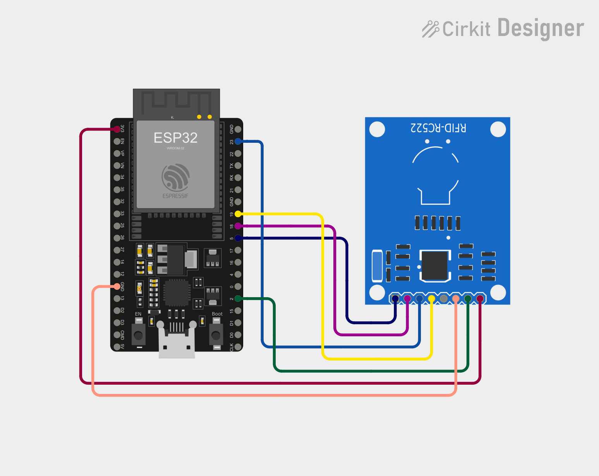

# Hardware

## Parts

| Part | Notes |
| --- | --- |
| ESP32 dev board (ESP32-WROOM-32) | Any "ESP32 Dev Module" board |
| RC522 RFID reader + cards/tags | 13.56 MHz |
| 7 female-female jumper wires | |
| USB data cable + 5V USB charger | The reader only needs power and 2.4 GHz Wi-Fi |

## Wiring (ESP32 ↔ RC522)

| RC522 pin | ESP32 pin | Wire colour in the diagram |
| --- | --- | --- |
| SDA (SS) | GPIO 5 | navy |
| SCK | GPIO 18 | purple |
| MOSI | GPIO 23 | blue |
| MISO | GPIO 19 | yellow |
| RST | GPIO 2 | green |
| 3.3V | 3V3 | red |
| GND | GND | orange |
| IRQ | not connected | grey |

> ⚠️ Power the RC522 from **3.3V only**. 5V can damage it.
>
> If uploading fails, unplug the RST wire from GPIO 2 during upload, then plug it back in.
